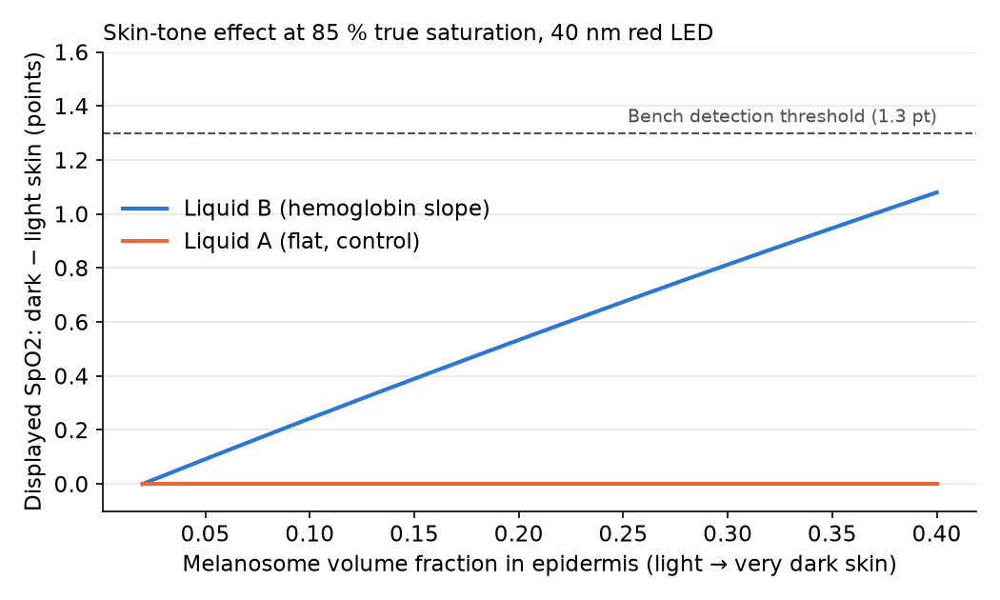
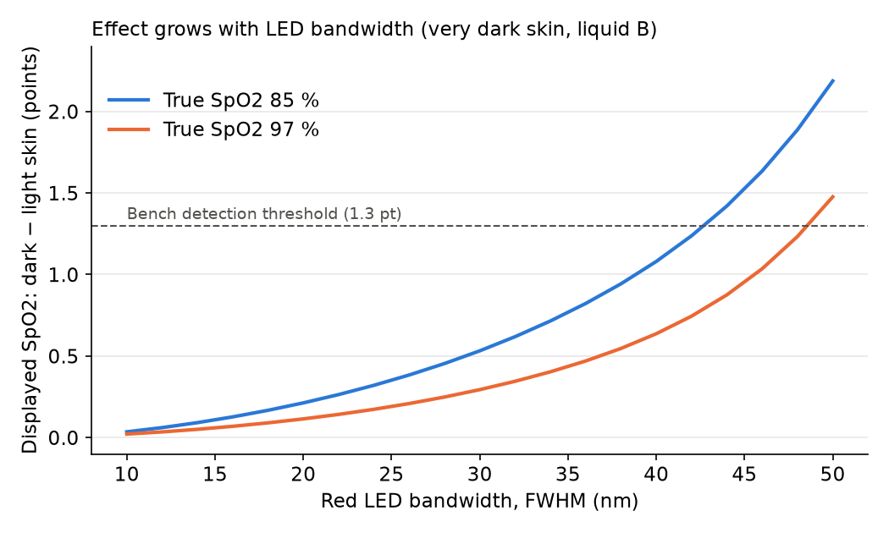

# Simulation: expected skin-tone bias on the bench

A simple optical model of a pulse oximeter, written before building the bench, to check whether the skin-tone effect will be large enough to measure.

## Question

Melanin absorbs short wavelengths more than long ones, so it shifts the light of the red LED by a few tenths of a nanometre to a few nanometres. Hemoglobin absorption changes quickly with wavelength in the red band, so this shift can bias the ratio R and the displayed SpO2. How large is this effect on the bench, with a pulsed liquid that has the hemoglobin slope (liquid B) or a flat one (liquid A, control)?

## Method

`bias_model.ipynb`, step by step:
1. Hemoglobin absorption from S. Prahl's tables (`data/`), melanin absorption from S. Jacques (2013), Gaussian LED spectra (660 nm and 940 nm).
2. Beer-Lambert law, wavelength by wavelength, through the skin and the pulsed liquid.
3. AC/DC for each LED, then R = (AC/DC red) / (AC/DC infrared).
4. Calibration on light skin, as a manufacturer would do; the bias is the displayed SpO2 on dark skin minus light skin.

## Results



- The model overestimates SpO2 on dark skin, and more at low saturation, as seen in clinical studies.
- Liquid A (flat) shows no effect at all: it is a valid negative control.
- With realistic skin, the effect stays below about 1.1 points, under the bench's detection threshold (1.3 points).



- The effect grows roughly with the square of the red LED bandwidth. At 85 % saturation, it exceeds the threshold only above about 42 nm.

## Consequences for the bench design

- Use skin sleeves more pigmented or thicker than real skin, to amplify the effect.
- Repeat each measurement 5 times instead of 3, and favour the low saturation level.
- Measure the LED spectrum of each oximeter, and include devices with wide red LEDs.

## Limits

This is an order-of-magnitude model, not a prediction of exact values: no light scattering, idealized LED spectra, approximate skin and blood parameters, and no proprietary oximeter algorithms. It tests only one possible cause of the clinical bias.

## How to run

```
python3 -m venv .venv && source .venv/bin/activate
pip install numpy matplotlib ipykernel
```

Then open `bias_model.ipynb` in VS Code or Jupyter and run all cells.

